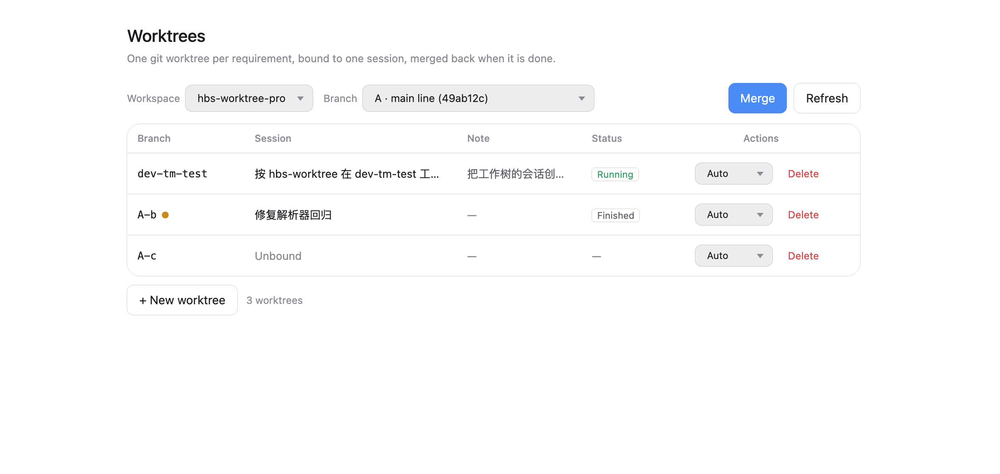
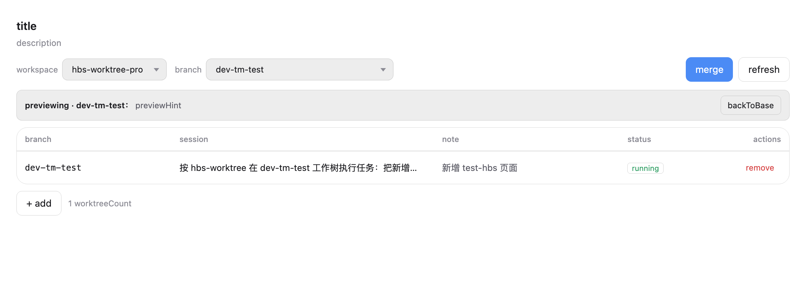
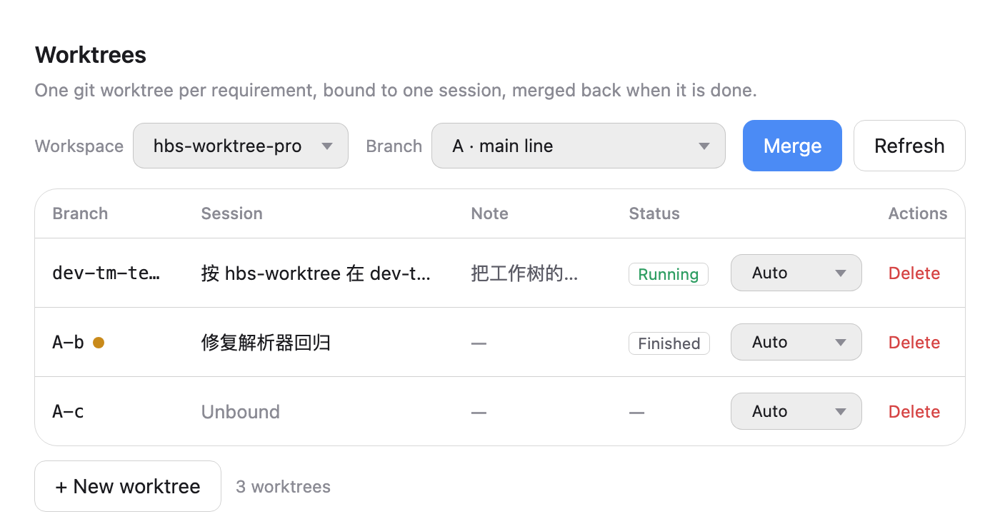

# hbs-worktree

One requirement, one git worktree, one dedicated session — for [DeepSeek Harness](https://github.com/deepseek-ai/deepseek-harness).

The AI edits its own checkout; the main business code stays clean; parallel requirements stop fighting over a single working directory; merging and cleanup are one click each.



## The problem it solves

Five symptoms, one root cause: **a project has a single working directory, but several large requirements run at once.**

1. **Two features, one checkout.** Feature A touches routing and shared components, feature B touches the product page — switching branches means stashing B, and half-finished edits come back as conflicts.
2. **You want to see A while B is running.** The main directory is held by B's dev server and editor; checking out A kills what B is running, not checking out means you cannot see A.
3. **Letting an AI write code is risky on paths.** The session's cwd is the project root, so a relative path lands in the main business code and may overwrite what someone else is editing.
4. **Merging is manual.** Push, switch, merge, dig through conflicts, remember to delete the temporary directory — skip one step and you collect orphaned checkouts.
5. **Deleting a worktree loses commits.** Remove the directory and the branch stays behind, but nobody remembers which was unmerged.

hbs-worktree makes the requirement a first-class thing: its own directory, its own branch, its own session — plus a panel to manage all of it.

## What it does

| Capability | What you do | What happens |
| --- | --- | --- |
| Start a requirement | New worktree: branch name, session name, note | Creates the branch + `.worktree/<branch>`, creates a session in the current workspace, names it, binds it, and sends the first instruction |
| Lock the directory | Nothing | The session's first message tells the agent to read the `hbs-worktree` skill and only touch absolute paths under `.worktree/<branch>` |
| Preview | Switch the branch picker | The main checkout shows that branch and can run; "back to main line" restores it |
| Merge | Merge dialog: source + target | Plain `git merge`; a conflict rolls back and lists the files |
| Commit | The actions dropdown: auto / manual (auto by default) | Auto: the session commits and pushes when done. Manual: you commit yourself |
| Clean up | Delete + confirm | Removes directory and branch; uncommitted or unmerged work needs a second confirmation |

## How it works

```
project/
├── .worktree/
│   ├── .hbs-state.json        # metadata only: base branch, session bindings, notes
│   ├── dev-a/                 # branch dev-a (requirement A)
│   └── dev-b/                 # branch dev-b (requirement B)
└── … main business code (checked out on the base branch)
```

- The worktree list comes from `git worktree list`; `.hbs-state.json` only remembers bindings and notes.
- `.worktree/` is written into `.git/info/exclude`: no `.gitignore` change, nothing to commit, and the main checkout never looks dirty because of it.
- Branch names with `/` work (`feature/tm/v-3.58.0` becomes `.worktree/feature/tm/v-3.58.0`).

**Why a detached HEAD when previewing?** `dev-a` is already checked out under `.worktree/dev-a`, and git refuses to check the same branch out twice. The main checkout shows that branch's content with a detached HEAD: files and behaviour are right, it runs, but commit from the worktree — the panel labels the state and offers a way back.

## Install

**One step: install the plugin.** Panel, CLI, and skill all ship inside the same bundle —
the skill never has to be installed separately.

### For users

1. Download `hbs-worktree-<version>.tgz` from this repository's **Releases**;
2. Install it with the Harness plugin manager ("install from local file");
3. Refresh the page.

No commands, no `npm link`, no copying into `~/.dsh/skills/`.

### From source

```bash
npm pack          # produces hbs-worktree-<version>.tgz, install that with the plugin manager
```

### What you get

| Piece | After installing | Still to do |
| --- | --- | --- |
| Panel | Settings → Worktrees | refresh the page |
| Skill | `hbs-worktree` appears in the session skill catalog, usable by new sessions | nothing |
| CLI | `~/.dsh/profiles/<profile>/node_modules/hbs-worktree/bin/` | nothing |

- **Why the skill needs no separate install:** it is not a file in `~/.dsh/skills/`; it lives in
  `assets/hbs-worktree.md` inside the bundle and the host half registers it via
  `ctx.skills.registerProvider(...)` on activation. Uninstalling the plugin removes it again.
- **Why the CLI needs no `npm link`:** the skill tries `hbs-wt` on `PATH` first, then
  `node "$DSH_PROFILE_DIR/node_modules/hbs-worktree/bin/hbs-wt.js"`. `npm link` is only for typing
  `hbs-wt` in your own terminal.
- **Requirement:** the panel needs the Host HTTP route, so it works in `dsh web` (browser)
  deployments; use the CLI inside the Electron shell.

## Quick start

1. **Settings → Worktrees** — pick the workspace (project) at the top.
   *Effect: you see the base branch, an empty table, and, for a plain directory, a clear "not a git repository" notice instead of buttons that would fail.*
2. **+ New worktree** — branch `dev-a`, session name, optional note.
   *Effect: branch created, checked out under `.worktree/dev-a`, a session created in this workspace, named, bound, revealed, and given its first instruction — in one click.*
3. **Work in that session** — the agent edits `.worktree/dev-a` only; the main code is untouched and the status column shows whether the session is running.
   When the requirement is done the session **commits and pushes by default**: it is a separate branch, so committing cannot touch the main code, while *not* committing means a preview is refused (dirty worktree) and the work is invisible. Switch the actions dropdown to "Manual" to opt out.
4. **Preview** — switch the branch picker to `dev-a`.
   *Effect: the main checkout shows that branch, so a dev server runs it; "back to main line" restores the base branch.*
5. **Merge** — pick source and target (the base branch by default).
   *Effect: plain merge; conflicts abort and list files, leaving no half-merged tree.*
6. **Delete** — with confirmation.
   *Effect: directory and branch removed; unmerged or dirty work asks for a second confirmation.*

## Panel




Narrow (700px) keeps the toolbar on one line:



## CLI

```bash
hbs-wt repo                        # current project: git?, base branch, current branch
hbs-wt list                        # every worktree with sessions, notes, ahead count
hbs-wt add dev-a --note rewrite    # create a worktree
hbs-wt bind dev-a                  # bind the current session
hbs-wt env                         # where this session should work
hbs-wt switch dev-a                # preview it in the main checkout
hbs-wt merge dev-a --into main     # merge
hbs-wt remove dev-a                # remove worktree and branch
hbs-wt prune                       # drop stale worktree metadata
```

`--json` prints the same envelope the panel uses (`{ok, data}` / `{ok, error}`).

## Session protocol

The `hbs-worktree` skill ships with the plugin and states seven rules: confirm the binding before writing, use absolute paths under the returned `root`, run git as `git -C <root>`, **commit when the requirement is done** (unless the worktree opted out of auto-commit), never switch or merge, report conflicts verbatim, and report what changed.

## State

`<project>/.worktree/.hbs-state.json` holds `{ base, preview, entries: { branch: { session, note, createdAt } } }`. Losing it loses bindings and notes, never code — the worktree list comes from git.

## FAQ

- **`git status` says `HEAD (no branch)` while previewing** — the branch is checked out elsewhere; content is right, commits belong in the worktree.
- **No `node_modules` in a worktree** — `git worktree add` checks out tracked files only; install what you need there.
- **Switching or merging needs a clean main checkout** — otherwise the dirty tree would be overwritten.
- **The panel says "switched" but the editor still shows the old branch** — the panel reads git's real state; the editor's branch indicator may simply be stale (it re-reads when the window regains focus, or click Refresh). A branch switched outside the panel is now reconciled instead of leaving a phantom "previewing" row that swallowed the next click.
- **"The worktree has uncommitted changes" when previewing** — a preview shows committed content only, so the panel refuses instead of hiding your work; commit first (that is why auto-commit is the default).
- **You cannot merge into a worktree branch** — git will not check out that branch twice.
- **Never run `git clean -xdf` in the main checkout** — `-x` would delete `.worktree/`.
- **Do other users need to install the skill separately?** No — it is registered by the plugin.
- **Do they need `npm link`?** No — only for typing `hbs-wt` themselves.
- **The panel needs `dsh web`** (the Host HTTP route); in the Electron shell use the CLI.

## Development

```bash
npm run check        # static checks + one live git round-trip
npm test             # engine and host tests
npm run shot         # render the panel against fixtures and screenshot it
```

Panel render tests need React and jsdom (test-only; the plugin has no dependencies):

```bash
NODE_PATH=<dir with react, react-dom, jsdom> node --test test/panel.render.test.mjs
```

## Layout

```
index.js                 host half: skill provider + POST /hbs-worktree/api
client.js                browser half: the Worktrees settings panel
lib/engine.js            engine: command table and state machine, no Harness imports
lib/git.js               git command wrappers
lib/state.js             .worktree/.hbs-state.json and info/exclude
bin/hbs-wt.js            CLI
assets/hbs-worktree.md   the skill shipped with the plugin
docs/CONTRACT.md         the contract between host, panel, CLI, and skill
docs/screenshots/        panel screenshots
test/                    engine, host, and panel render tests
scripts/                 check.mjs (self-check) and screenshot.mjs
```

## License

MIT
