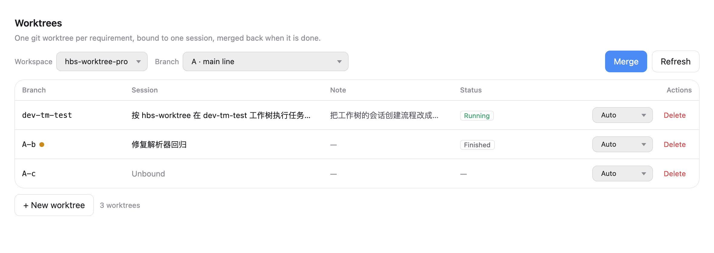
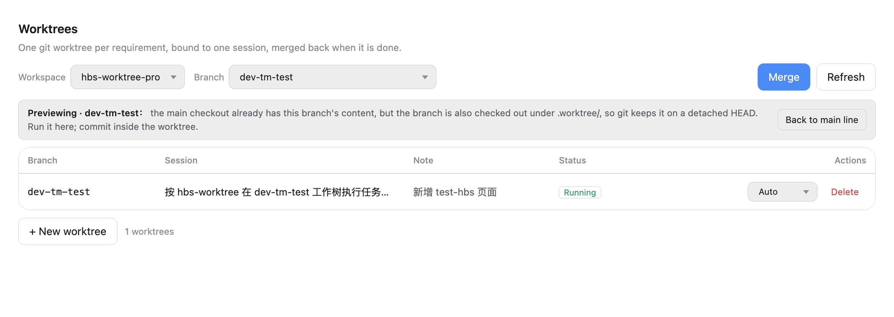
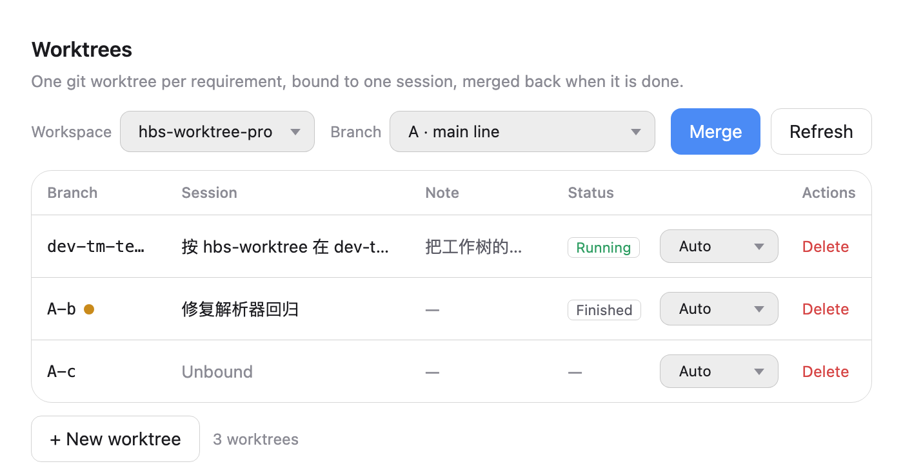

# 工作树 · hbs-worktree

给 [DeepSeek Harness](https://github.com/deepseek-ai/deepseek-harness) 加一层「**一个需求 = 一个 git 工作树 = 一个专属会话**」的管理面板：
AI 在自己的工作树里改代码，主业务代码保持干净；需求并行跑，互不打扰；做完一键合并，删掉不留垃圾。



## 它解决什么

下面这五件事，是同一个问题的五个阶段——**一个项目同时推进多个大范围需求，但项目只有一份工作目录**：

1. **两个大需求同时改，一份目录来回切。**
   A 在改路由和公共组件，B 在改商品详情，共用一个工作目录：切一次分支 stash 一次，改到一半切走，回来还得恢复现场。
2. **想看 A 的效果，但 B 的会话正在跑。**
   主目录被 B 的 dev server 和编辑器占着，一 checkout 就把 B 跑着的东西顶掉；不切又看不到 A。
3. **让 AI 干活，最怕它改错目录。**
   会话的工作目录是项目根，AI 用相对路径改文件，很可能落到主业务代码里，顺手把别人正在改的东西也动了。
4. **做完想合并，全手动。**
   push、切分支、merge、冲突了翻文件清单、合并完还记得去删临时目录——漏一步就留一堆没人认领的工作目录。
5. **删工作树时丢提交。**
   目录一删，分支还在但没人记得；没合并的提交就这么蒸发了。

这五个阶段的解法是同一件事：**把「需求」变成一等公民，给它独立的目录、独立的会话、独立的分支，然后用一块面板管起来。**

## 它能做什么

| 能力 | 你在面板上做什么 | 背后发生什么 |
| --- | --- | --- |
| 开一个需求 | 新增工作树：填分支名、会话名、备注 | 建分支 + 建目录 `.worktree/<分支>` + 在当前项目里新建会话 + 命名 + 绑定 + 自动发出首条指令 |
| 锁住目录 | 不用做，自动 | 会话收到的第一条话就是「读 hbs-worktree skill，只改 `.worktree/<分支>` 下的绝对路径」 |
| 看效果 | 分支下拉切到该分支 | 主目录变成该分支的内容，可起 dev server；点「回到主业务」还原 |
| 合并 | 点「合并」，选源分支和目标分支 | 普通 `git merge`；冲突自动回滚并列出文件，不留半成品 |
| 提交 | 操作列的下拉：自动提交 / 手动提交（默认自动） | 自动：会话做完需求自己 commit + push；手动：你自己提交 |
| 清理 | 点「删除」并二次确认 | 删目录 + 删分支；有未提交改动/未合并提交时要求再确认一次 |
| 命令行 | `hbs-wt ...` | 同一套引擎，给终端和 agent 用 |

## 工作原理

一个仓库，多条分支，每条分支检出在自己的目录里：

```
项目/
├── .worktree/
│   ├── .hbs-state.json        ← 只有元数据：主业务分支、会话绑定、备注
│   ├── dev-a/                 ← 分支 dev-a（需求 A）
│   └── dev-b/                 ← 分支 dev-b（需求 B）
└── …主业务代码（检出的是主业务分支）
```

- 工作树列表以 `git worktree list` 为准，`.hbs-state.json` 只存「谁绑了哪个会话、备注是什么」。
- `.worktree/` 自动写进 `.git/info/exclude`：不改 `.gitignore`、不需要提交、不会让主业务代码变脏。
- 分支名支持 git 规范里的 `/`，例如 `feature/tm/v-3.58.0`，建出来是 `.worktree/feature/tm/v-3.58.0`。

**为什么预览时是 detached HEAD？**
`dev-a` 已经被 `.worktree/dev-a` 检出，而 git 不允许同一个分支被两处同时检出。所以主目录只能以 detached HEAD 的方式显示它的内容——文件、页面都对，可以直接运行，但**提交要回工作树里做**。面板会标「预览中」，并给一个「回到主业务」按钮。

## 安装

**只需要装插件，没有第二步。** 面板、CLI、skill 三样都在同一个 bundle 里，skill 不需要单独安装。

### 别人怎么用

1. 从本仓库的 **Releases** 下载 `hbs-worktree-<版本>.tgz`；
2. 在 Harness 的插件管理器里选「从本地安装」，指向这个 tgz；
3. 刷新页面。

不用敲命令、不用 `npm link`、不用把 skill 复制到 `~/.dsh/skills/`。

### 自己从源码装

```bash
npm pack          # 生成 hbs-worktree-<版本>.tgz，再用插件管理器安装
```

### 装完就有了什么

| 东西 | 装完的状态 | 还要做什么 |
| --- | --- | --- |
| 面板 | 设置 → 工作树 | 刷新页面 |
| skill | 会话技能目录里出现 `hbs-worktree`，新会话可直接用 | 无 |
| CLI | 落在 `~/.dsh/profiles/<profile>/node_modules/hbs-worktree/bin/` | 无 |

- **skill 为什么不用单独装**：它不是放在 `~/.dsh/skills/` 的独立文件，而是打包在插件里
  （`assets/hbs-worktree.md`），插件激活时由宿主半边 `ctx.skills.registerProvider(...)` 注册进技能目录。
  卸载插件，skill 同步消失。
- **CLI 为什么不用 `npm link`**：skill 里写了两段式调用——先试 PATH 上的 `hbs-wt`，没有就用
  `node "$DSH_PROFILE_DIR/node_modules/hbs-worktree/bin/hbs-wt.js"`（`DSH_PROFILE_DIR` 在会话里一定存在）。
  只有你自己想在终端里直接敲 `hbs-wt` 时，才需要 `npm link`。
- **前提**：面板走宿主 HTTP 路由，只在 `dsh web`（浏览器）部署下可用；Electron 桌面壳里请用 CLI。

## 快速上手

每一步写清「做什么 → 什么效果」。

### 第 1 步：打开面板

设置 → **工作树**。

> **效果**：顶部能看到 Harness 的工作区下拉（默认当前项目）、分支下拉（主业务分支）、空表格。
> 如果选中的目录不是 git 仓库，这里会直接告诉你「当前主业务代码未初始化 git」，不会让你在死路上点按钮。

### 第 2 步：新增一个工作树

点「+ 新增工作树」，填三样：

| 字段 | 例子 | 说明 |
| --- | --- | --- |
| 分支名 | `dev-a` | 新分支名，从主业务分支切出 |
| 会话名 | `详情页改版` | 会在当前项目里新建一个会话，用这个名字 |
| 备注 | `商品详情页重构` | 选填，只给自己看 |

> **效果**（一次点击做了六件事）：
> 1. 建分支 `dev-a`，并从主业务分支切出；
> 2. 在 `.worktree/dev-a` 检出它——这一步之后主业务代码完全不受影响；
> 3. 在**当前工作区**里新建一个 Harness 会话，名字用你填的；
> 4. 把会话绑定到这个工作树，`hbs-wt env` 立刻能查到目录；
> 5. 把会话显示出来（自动跳过去）；
> 6. 自动发出第一条指令，内容是「读取 hbs-worktree skill，工作目录是 `.worktree/dev-a`，只用绝对路径和 `git -C`」。

### 第 3 步：让 AI 干活

在刚打开的会话里正常提需求。

> **效果**：AI 的每次读写都发生在 `.worktree/dev-a` 里；主业务代码、其它工作树、`.hbs-state.json` 它都不会碰。
> 表格的「状态」列会显示这个会话「运行中 / 已完成」。
>
> **需求做完，会话会自动提交并推送**（`add -A` + `commit` + `push`）。这是刻意要求的：工作树是独立分支，
> 提交不会影响主代码；反过来如果不提交，你切过去会被拒绝（工作树有未提交改动），而且切过去看到的还是旧内容。
> 不想让它自动提交，就把操作列的下拉切成「手动提交」。

### 第 4 步：切过去看效果

用顶部**分支下拉**选 `dev-a`。

> **效果**：主目录的文件立刻变成 `dev-a` 的内容，可以起 dev server 直接看。
> 如果 `dev-a` 的工作树里还有没提交的改动，切换会被拒绝并提示先提交——因为切过去也看不到那些改动。
> 面板显示「预览中 · dev-a」和一行说明，右侧「回到主业务」一键还原。
> 注意：此时主目录是 detached HEAD，提交请回工作树里做。

### 第 5 步：合并

点「合并」，在弹窗里选源分支（`dev-a`）和目标分支（默认主业务分支）。

> **效果**：执行普通 `git merge`。
> - 没有冲突：直接合并成功，主业务分支前进。
> - 有冲突：自动 `merge --abort` 回滚，并列出冲突文件清单——不会留下半合并的现场，你解决后再点一次即可。

### 第 6 步：清理

在表格里点「删除」，二次确认。

> **效果**：删掉 `.worktree/dev-a` 目录 + 删掉 `dev-a` 分支，不留临时文件。
> 如果还有未提交改动或未合并提交，会拦一次并给出「强制删除」——避免手滑丢代码。

## 面板




窄屏（700px）下工具栏不换行，下拉收窄、按钮留位：



## 命令行

```bash
hbs-wt repo                        # 当前项目状态：是否 git、主业务分支、当前分支
hbs-wt list                        # 全部工作树（含会话、备注、领先提交数）
hbs-wt add dev-a --note 详情页改版  # 建工作树
hbs-wt bind dev-a                  # 把当前会话绑到工作树
hbs-wt env                         # 本会话该在哪个目录干活
hbs-wt switch dev-a                # 主业务目录预览 dev-a
hbs-wt merge dev-a --into main     # 合并
hbs-wt remove dev-a                # 删工作树与分支
hbs-wt prune                       # 清理僵尸 worktree 元数据
```

`--json` 输出与面板共用同一套信封（`{ok, data}` / `{ok, error}`）。

## 会话绑定协议

随插件分发的 `hbs-worktree` skill 规定了 7 条硬规矩：

1. 先确认绑定（`hbs-wt env`），没绑定不改代码；
2. 只用绑定返回的 `root` 下的**绝对路径**；
3. git 命令一律 `git -C <root>`，不碰主业务目录；
4. **需求做完必须提交**（`autoCommit` 为 `false` 时除外）：独立分支提交不影响主代码，
   不提交则用户切不过去、也看不到成果；
5. 不切分支、不合并、不删工作树——这些是用户在面板上的动作；
6. 冲突原样上报文件清单，不自动 resolve、不 `--force`；
7. 最后回报改了哪些文件、提交几次、是否已推送。

## 状态放在哪

```
.worktree/
├── .hbs-state.json     # { base, preview, entries: { 分支: { session, note, createdAt } } }
└── <分支>/             # 工作树本体
```

工作树是否存在以 `git worktree list` 为准；`.hbs-state.json` 丢了只会丢会话绑定和备注，不会丢代码。

## 常见问题

**为什么预览时 `git status` 显示 `On branch` 而不是分支名？**
因为该分支正在自己的工作树里检出，git 不允许第二处检出，主目录只能是 detached HEAD。内容是对的，能运行，不能在这里提交。

**工作树里为什么没有 `node_modules`？**
`git worktree add` 只检出被 git 跟踪的文件。会话只写代码、不跑构建；要在工作树里跑东西，需要自己装依赖（或让 AI 装）。

**为什么切换时提示「工作树还有未提交的改动」？**
预览只会显示分支的提交内容。工作树里没提交的改动切过去看不到，所以面板直接拦下来，
让你或会话先提交——这也是默认开启「自动提交」的原因。

**主业务目录有未提交改动，为什么不能切换/合并？**
切换和合并都会改写主目录，脏工作区会丢现场。面板会先拦下来，让你提交或 stash。

**目标分支不能选某个工作树分支？**
那个分支正被自己的工作树检出，git 不允许再被检出为合并目标。选主业务分支或普通分支即可。

**非 git 项目怎么办？**
面板顶部会直接提示「当前主业务代码未初始化 git」，不会渲染任何会失败的操作。

**`git clean -xdf` 会怎样？**
会连 `.worktree/` 一起删掉（`-x` 连忽略文件也删）。在主业务目录别随手用 `-x`。

**别人用的时候要单独装 skill 吗？**
不用。skill 随插件注册，装完插件后新会话就有 `hbs-worktree`；卸载插件它同步消失。

**别人装完还需要 `npm link` 吗？**
不需要。只有他要自己在终端里敲 `hbs-wt` 才需要；会话里的 AI 走 skill 里的兜底路径。

**Electron 桌面壳里能用吗？**
面板走宿主 HTTP 路由，只在 `dsh web`（浏览器）部署下可用；桌面壳里请用 CLI。

## 开发

```bash
npm run check        # 静态检查 + 一次真实 git 往返（22 项）
npm test             # 引擎 18 + 宿主 5
npm run shot         # 用固定数据渲染面板并截图（需要 react/react-dom/jsdom 在 NODE_PATH）
```

面板渲染测试（14 项）需要 React 与 jsdom，只是测试期依赖，插件本身零依赖：

```bash
NODE_PATH=<装着 react react-dom jsdom 的目录> node --test test/panel.render.test.mjs
```

## 目录结构

```
index.js                 宿主半边：注册 skill provider + 暴露 /hbs-worktree/api
client.js                浏览器半边：设置里的「工作树」面板
lib/engine.js            引擎（命令表 + 状态机），不依赖任何 Harness 包
lib/git.js               git 命令封装
lib/state.js             .worktree/.hbs-state.json 与 info/exclude
bin/hbs-wt.js            CLI
assets/hbs-worktree.md   随插件分发的 skill
docs/CONTRACT.md         宿主 / 面板 / CLI / skill 四方接口契约
docs/screenshots/        面板截图
test/                    引擎、宿主、面板渲染测试
scripts/check.mjs        自检；scripts/screenshot.mjs 截图工具
```

## License

MIT
